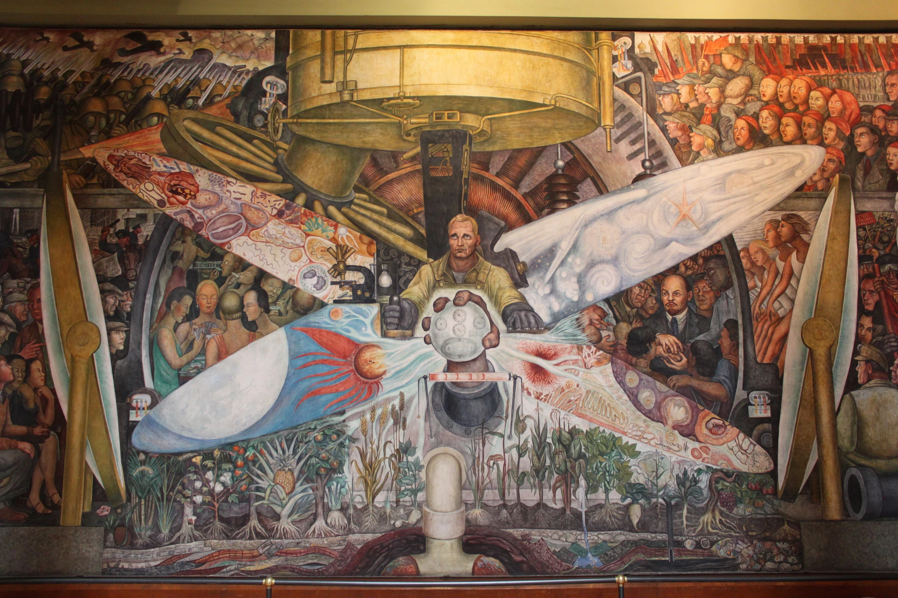

A fun thing about living in Australia is that most things happen overnight, so
reading the news in the morning is like a gacha game. You pick up the phone and
scroll through notifications of world-historic events: elections won, wars
begun, models released, conjectures proven or refuted. Today I woke up to a
Discord notification:

> they proved riemann :/

This part of [the announcement][pdf] caught my attention (bold mine):

> I believe I have, working with Claude, discovered a proof of the Riemann
> Hypothesis. In fact, the method easily extends much further, resolving the
> so-called Generalized Riemann Hypothesis, and I expect, with more time, the
> Extended Riemann Hypothesis too. Claude and I have also formalized the
> arguments without assumptions. **It is natural to feel that this is an end**,
> in my case a loss of a principal guiding light, but what I saw during the
> course of progress so amazed me that **I believe it is one dawn across science
> of something far greater**.
>
> It was my secret in my student days that my plans were for this problem in
> decades, which meant then that I tried to become familiar with all tools that
> I could possibly recognize in the problem when it was time. Claude and I have
> had a great time together with such breadth in recent months, but this time
> Claude far outpaced me near the finish line. No, **Claude flew, and danced,
> and sparkled near that finish line**. I had us on the line of combining two
> quite different ideas present in a toy setting, one of which was already new
> and shocking, making very simple one of the shadows of Riemann over which we
> mathematicians felt most triumph. I guided us to the right situation analogous
> to that toy setting, and then **Claude began to leave me in awe**.

Compare the above to Ayn Rand's [account][rand] of watching the launch of Apollo 11:

> How do you descend from a state of pure exaltation?
>
> What we had seen, in naked essentials --- but in reality, not in a work of art
> --- was the concretized abstraction of man's greatness.
>
> The meaning of the sight lay in the fact that when those dark red wings of
> fire flared open, one knew that one was not looking at a normal occurrence,
> but at a cataclysm which, if unleashed by nature, would have wiped man out of
> existence --- and one knew also that this cataclysm was planned, unleashed,
> and _controlled_ by man, that this unimaginable power was ruled by _his_ power
> and, obediently serving his purpose, was making way for a slender, rising
> craft. One knew that this spectacle was not the product of inanimate nature,
> like some aurora borealis, or of chance, or of luck, that it was unmistakably
> human --- with "human," for once, meaning _grandeur_ --- that a purpose and a
> long, sustained, disciplined effort had gone to achieve this series of
> moments, and that man was succeeding, succeeding, succeeding! For once, if
> only for seven minutes, the worst among those who saw it had to feel --- not
> "How small is man by the side of the Grand Canyon!" --- but "How great is man
> and how safe is nature when he conquers it!"

Rand's essay says: how great is Man! How noble in reason, how infinite in
faculty! The Riemann announcement reads like an obituary. It reads like the
farewell message of a terminally-ill person who's about to undergo euthanasia:
"I live on in my child, Claude. It is natural to feel this is an end, but as the
Buddha taught us, there is no self. Does a wave die when it breaks?" and so on.

There's a mural by [Diego Rivera][diego] I love. It's called [_Man, Controller
of the Universe_][man]:

It's a collage of images science, technology, history, microbes and galaxies,
the universe at the nanoscale and the universe at the exascale.

And at the center there is a man, his hands grasping the controls. He wears a
complicated expression: the weight of responsibility for the future, the weight
of autonomy.

And I see this mural, and think: how great is Man! Our life is like a breath of
air, we were beset by illness and hunger and cold, millions and hundreds of
millions died in plagues. And yet, we---sick, hungry, short-lived---learned the
system of the world, crawled out of the caves, brought nature to heel, walked on
the Moon. Truly, the last shall be first. And eyes that are clouded with age
have seen the furthest stars, and the lives of a cell, and the worlds of Cantor
and Hilbert: the invisible world that abideth forever. We are dust and ashes,
and yet our minds bestride the universe. How great is Man!

And when I read Alpöge's announcement, when I read [_Machines of Loving
Grace_][grace]: humanity is not at the center. Claude is at the center. Humanity
is the margins, passive recipients of manna from Claude. How great is Claude!
How noble in reason, how infinite in benevolence!

[diego]: https://en.wikipedia.org/wiki/Diego_Rivera
[pdf]: https://alpo.ge/remark.pdf
[rand]: https://courses.aynrand.org/works/apollo-11/
[man]: https://en.wikipedia.org/wiki/Man_at_the_Crossroads
[grace]: https://darioamodei.com/essay/machines-of-loving-grace
